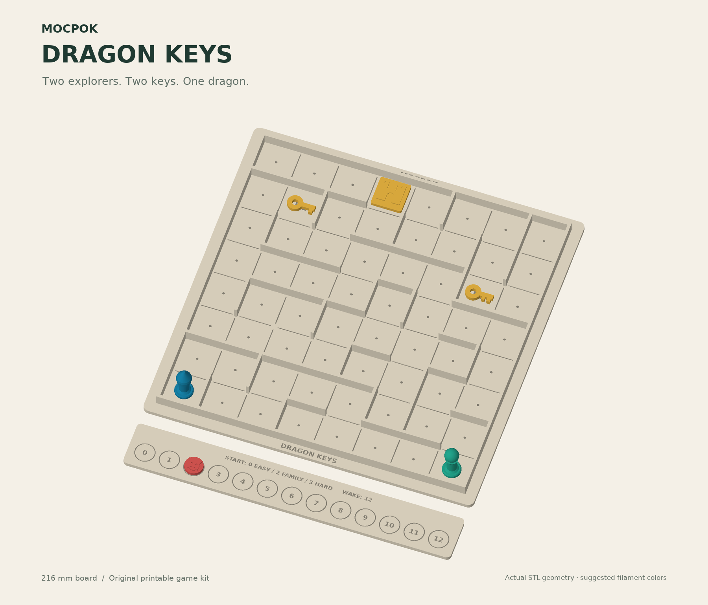

# MocPok

**Imagine it. Make it. Play together.**

MocPok is an AI game maker for kids and families, created by Teddy (10) and Hugo (7) at [LOCALHOST](https://localhostai.nyc/), New York's sovereign AI hackathon, on November 7, 2026.

You describe a game in your own words, any kind of board game. MocPok designs it and draws a printable board. Try *"Create a property game, but use Williamsburg as the location"* for a property-trading board with real Williamsburg landmarks, or *"a mah-jong-like game with trees"* for a sheet of tiles. Maze adventures also get a **3D-printable board (STL)**. It takes 5–20 seconds and runs entirely on your own laptop. There's no cloud, no account and no API key, and nobody else sees your kids' ideas.



## Our first game: Dragon Keys

Two explorers. Two magic keys. One sleeping dragon. Work together to find the keys and escape before the dragon wakes up.

Dragon Keys is a real 3D-printed game, and every other MocPok game is built on its rules. The full print kit is in [`dragon-keys/`](dragon-keys/): STL files, Bambu Studio projects, a print-and-play guide and the rules.

## Run it (about 5 minutes)

You need a Mac (or any computer) with [Ollama](https://ollama.com) and Python 3.9 or newer. No Python packages are needed.

```bash
ollama pull qwen3:4b
ollama create mocpok -f Modelfile
python3 server.py
```

Open **http://127.0.0.1:8765**, describe your adventure, and click **Create my adventure**. On a Mac you can also double-click `Start_MocPok.command`, which uses port 8766.

Each game is saved in `projects/<id>/` as `plan.json`, `board.svg`, `board.stl`, `rules.md` and `print-kit.zip`.

## How it works

The AI is Qwen3 4B, an open-weight Apache-2.0 model, running locally in Ollama. We customized it with our own instructions, and it returns structured JSON. It first picks one of five kinds of board:

| Kind | The AI writes | Code does |
|---|---|---|
| **Maze adventure** (Dragon Keys) | Title, theme, mission, difficulty, maze seed | Tested fixed rules. An 8×8 maze (`maze.py`) checked so every square can be reached. SVG plus a 216 × 216 mm watertight **STL**. |
| **Property board** | Title and story | A 24-space square loop. Real landmarks come from a hand-checked list for known neighborhoods (Williamsburg today), so the AI can't invent places. Simple fixed money rules that match the printed prices. |
| **Race track** | All the rules and the special spaces | Draws a 30-space track |
| **Grid board** | All the rules and the piece names | Draws an 8×8 board with a legend |
| **Tiles and cards** | All the rules and the tile faces | Draws a 24-tile cut-out sheet |

We learned the hard way that a small model will happily invent rules or places that don't exist. Where we could, the AI writes the story and our code keeps the rules fair and the places real. The design module is `anygame.py`.

The server only listens on `127.0.0.1` and makes no requests outside your computer. For more detail, see [`docs/TECHNICAL.md`](docs/TECHNICAL.md).

### What it is not (yet)

- **The model has not been fine-tuned or trained.** It's an existing open model with our own instructions on top.
- **Rulebook search is small.** `library.py` can pass up to three short excerpts from a local rulebook index to the model. Our demo index has 4 rule summaries (Pandemic, Forbidden Island, Labyrinth, Carcassonne). The index isn't in this repo because it contains third-party rule text. Without it, MocPok works the same, just with no excerpts.
- **New boards are checked by code, not playtested.** Dragon Keys itself is a physical prototype. Rules for race, grid and tile games are written by the AI, so play a round and fix anything that isn't fun.
- **Only Williamsburg has a checked landmark list so far.** For other places, the board uses the AI's own place names, so check them.
- **No trademarks on the board.** You can ask for "a monopoly," but MocPok gives the game its own name and its own spaces.

## What's next

- Fine-tune a small open model on the roughly 3,100 game-rule documents we collected (traditional games from the Ludii project, public-domain rule books and more), so MocPok can invent new **rules** as well as new stories. The collector scripts and the full metadata list are in [`rules-corpus/`](rules-corpus/). The rule text isn't included for copyright reasons, but the scripts rebuild it.
- More board shapes and pieces than the 8×8 maze.
- A one-click print path for family 3D printers.

## Credits

Made by Teddy and Hugo, with help from their dad and AI coding assistants. Uses [Qwen3](https://github.com/QwenLM/Qwen3) (Apache 2.0) through [Ollama](https://ollama.com).

MIT License. See [`LICENSE`](LICENSE).
